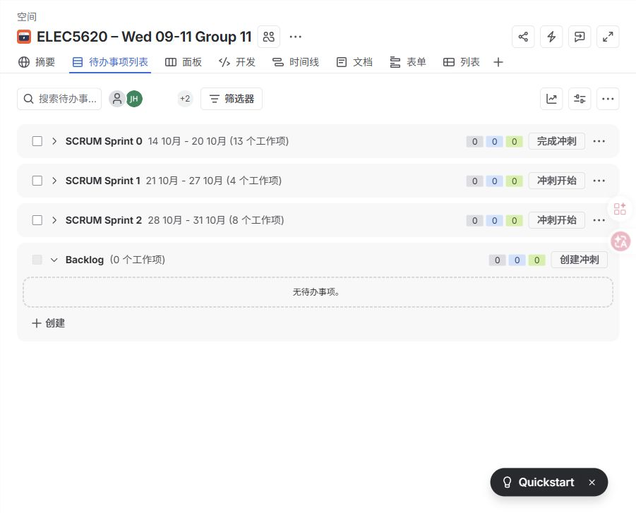

# Agile evidence and remaining gaps

This is a retrospective compilation of existing evidence on 30 October 2026, not minutes of meetings that were never recorded. Source data: [Jira board](https://f1orestyinlem.atlassian.net/jira/software/projects/SCRUM/boards/1/backlog), Git history, and [selected actual PR reviews](evidence/pr_history.json).

## Planned iterations versus observed Jira state

| Iteration | Planned dates | Planned scope | Observed on 30 October |
| --- | --- | --- | --- |
| Sprint 0 | 14–20 October | Shared contracts and five minimum scenarios | Backlog still offers Complete sprint; several shared tasks are Done |
| Sprint 1 | 21–27 October | Complete workflows, modes/feeding/escalation/extensions | Backlog offers Start sprint; visible Pet/Smart Home tasks remain In Review |
| Sprint 2 | 28–31 October | Acceptance, integration, deployment and safety review | Backlog offers Start sprint; several acceptance tasks remain To Do despite code evidence |

These buttons are actual observed UI states, not proof the planned sprints ran on those dates. The observed board has no story-point estimates on the visible tasks. The reports view was not available in its current navigation, and a direct report-view attempt returned 404. No authentic historical burndown chart was obtained. This repository therefore contains **no fabricated burndown**, and makes no claim that Git commits substitute for Jira sprint reports. The team should reconcile present task statuses with owners and attach any genuine report available in Jira. Do not backdate work or estimates to manufacture a trend.

## User stories and ownership

The following are current reformulations of existing issue scope, not claims these exact sentences were written at sprint inception. Jira remains authoritative for assignment and acceptance criteria.

| Jira | Owner | Story | Acceptance / evidence |
| --- | --- | --- | --- |
| SCRUM-12 / 24 / 25 | Yuanbo Zhang | As a resident, I want a suspected fall assessed and clarified so that help can be requested when needed. | Fall, safe/help/unclear reply, escalation and acceptance tests |
| SCRUM-26 / 27 | Yang Yang | As a homeowner, I want a supported home command applied and verified so that I can trust the displayed outcome. | Multi-device, approval, offline and readback tests; PR #7 |
| SCRUM-14 / 28 / 29 | Jinjing Huang | As a pet owner, I want food/activity alerts and explicitly authorized simulated feeding so that monitoring works even when the feeder fails. | Pet monitoring/integration/Sprint 2 tests; PR #8 |
| SCRUM-15 / 30 / 31 | Yan Li (Flora) | As a homeowner, I want hazard/intrusion warnings assessed and safely handled so that unsafe or unapproved actions do not run. | Security, confirmation and external-warning tests |
| SCRUM-16 / 32 / 33 | Tianzhuo Li | As a resident, I want comfort and energy context assessed and permitted adjustments verified so that safety takes priority. | Energy assessment/eligibility/control tests; cross-domain work in PR #17 by Jinjing's branch |
| SCRUM-34–38 | Respective domain owners | As a reviewer, I want repeatable expected/actual scenarios so that integration failures can be reproduced. | Domain acceptance runners and page tests |
| SCRUM-39 / 42 | Shared integration / safety owners | As a reviewer, I want invalid goals and active safety incidents to block comfort actions so that optional automation cannot override protection. | Faulty-proposal regression and actual cross-page safety test |
| SCRUM-41 | Jinjing Huang | As a demonstrator, I want the submitted source rebuilt in a clean environment so that deployment can be reproduced. | CI/container verification and final Canvas rehearsal (latter still required) |

## Documented feedback loops

| Real evidence | Feedback / observation | Actual refinement | Verification |
| --- | --- | --- | --- |
| [PR #8 requested changes](https://github.com/tianzhuoli11/ELEC5620/pull/8#pullrequestreview-5637402410) | Feeder read timeout stopped core assessment/alert/audit; widget reset warning | Commits `ce5a131`, `dd5a7e2`: UNAVAILABLE boundary, regressions, widget initialization fix | Reviewer explicitly [approved after rerunning 134 tests](https://github.com/tianzhuoli11/ELEC5620/pull/8#pullrequestreview-5640680543) |
| PR #17 integration inspection and commits `50d1604`, `4e7607e` | A valid but incorrect model proposal could reverse a negated request; Energy control lacked cross-domain clearance | Pre-model negation guard, target consistency checks, executable simulation, fresh safety registry and per-dispatch interlocks | 275-test run, including live AI and cross-page success→smoke→block |
| PR #19, commit `c0ec9d2` | Integrated main needed fresh Elderly acceptance evidence | Acceptance report rerun against the integrated source | `docs/acceptance/ELDERLY_SAFETY_ACCEPTANCE.md` |
| PR #20, [first container CI failure](https://github.com/tianzhuoli11/ELEC5620/actions/runs/41048246193) | Tests attempted to create temporary files under non-root read-only `/app` | Commits `546400d` and `986de17`: use the system temporary directory in all affected tests | [Independent Python and container verification passed](https://github.com/tianzhuoli11/ELEC5620/actions/runs/41048545525) |

PR #17 and #19 are merged but the queried GitHub review arrays are empty. A merge is not represented here as written review approval. Chat-led inspection of #17 is not relabeled as external user testing.

## Review and retrospective status

The records above substantiate code iteration and a concrete peer feedback loop. No contemporaneous Sprint 0/1 review or retrospective minutes were supplied or found in the checked repository. Sprint 2 team sign-off, the full demonstration rehearsal, and the final retrospective remain to be recorded when they actually occur. Suggested prompts for that real session: what failed, what changed, who verified it, what remains, and which issue/PR carries the follow-up. Do not mark a Jira item Done solely because this document lists it.

## Two-minute demo evidence

Open Jira for actual task allocation and sprint state; show PR #8's requested-changes and approval sequence, then one later integration improvement and its tests. Show the real Actions run and deployment verification once they exist. State the burndown/retrospective limitations honestly instead of presenting a retrospective reconstruction as original sprint evidence.
