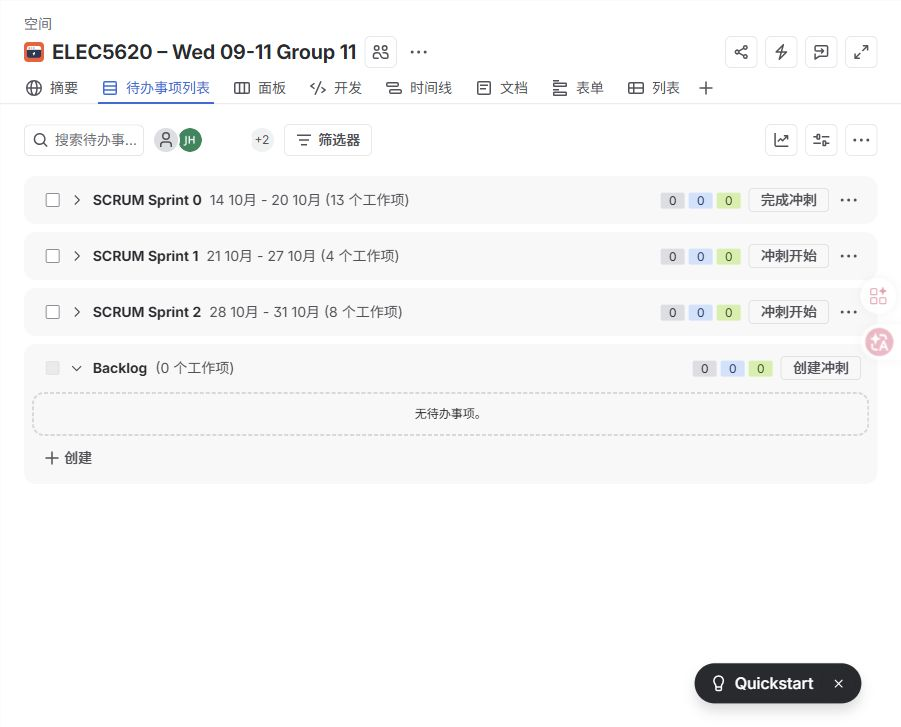
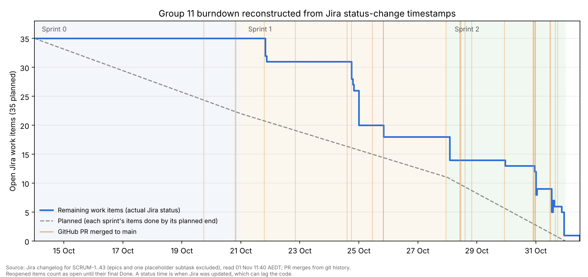
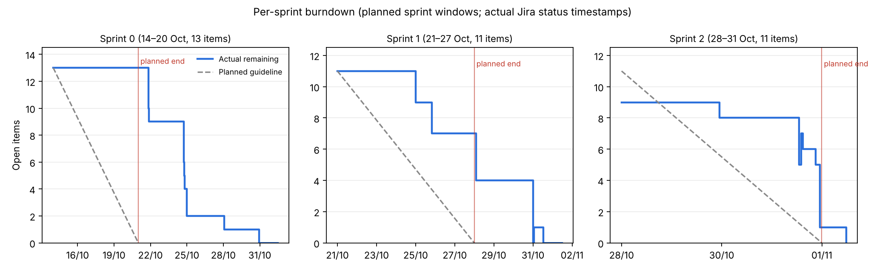
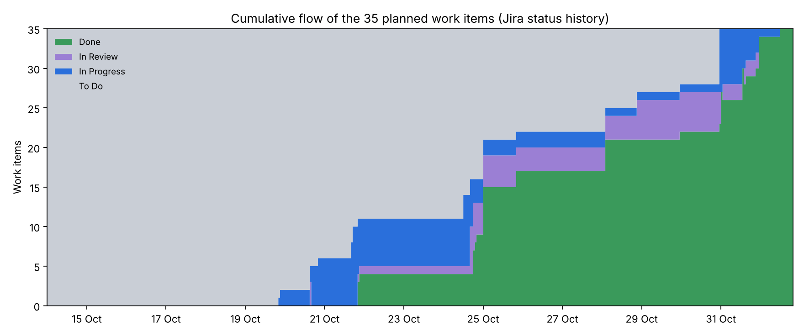
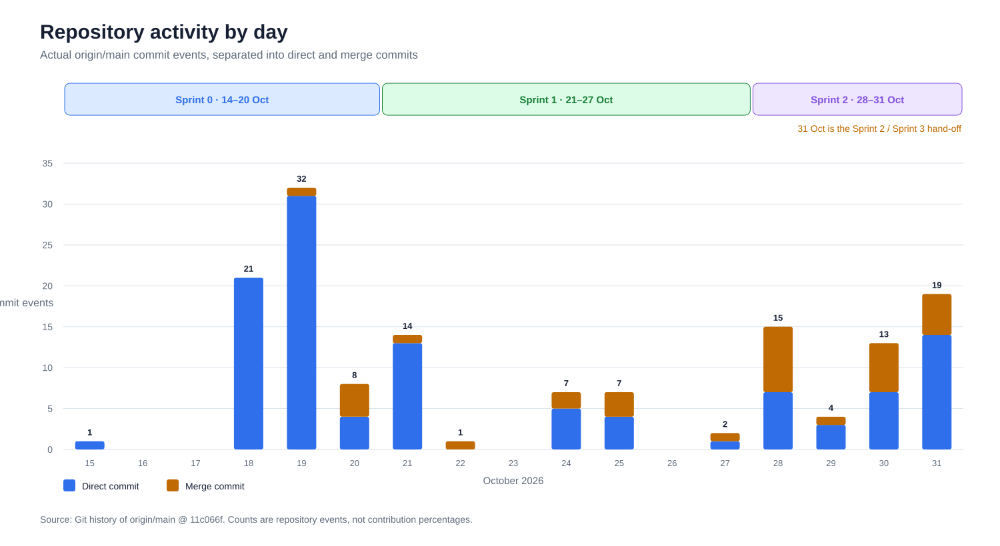
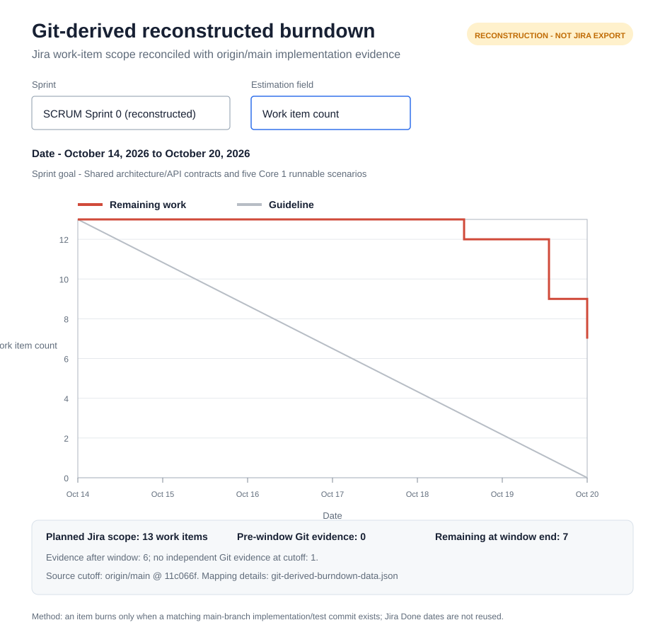
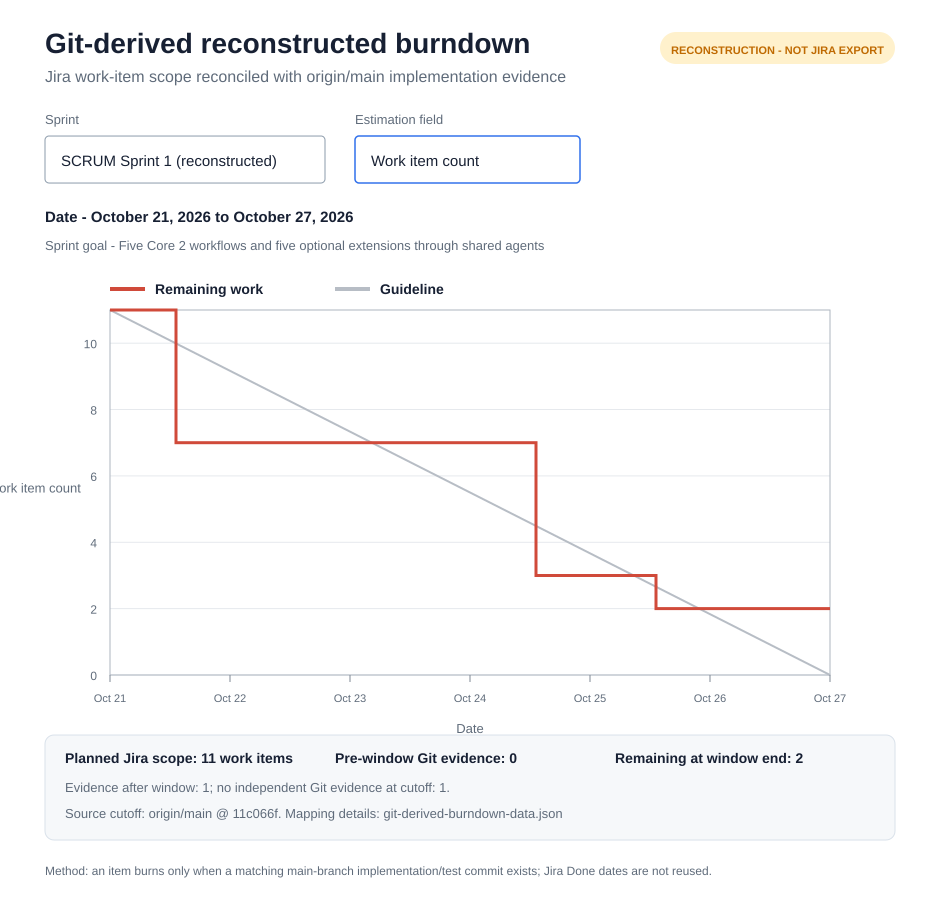
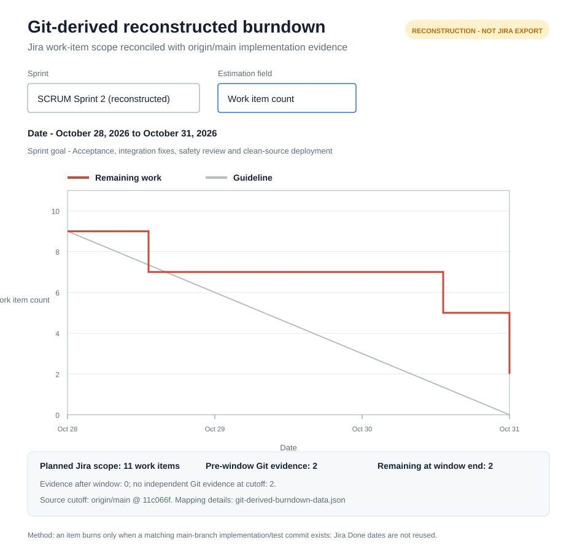
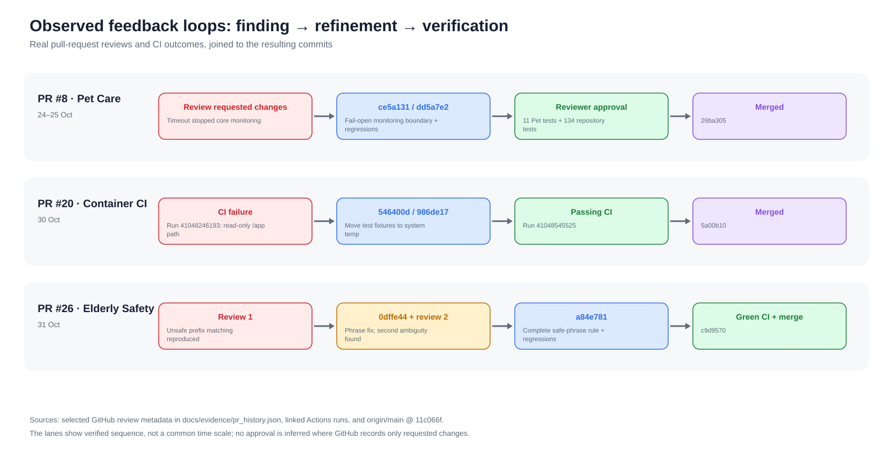

# Agile evidence and remaining gaps

This is a compilation of existing evidence, first written on 30 October 2026 and updated on 1 November 2026 with burndown charts rebuilt from Jira history and the sprint review records in [SPRINT_REVIEWS.md](SPRINT_REVIEWS.md). It does not contain minutes of meetings that were never held. Source data: [Jira board](https://f1orestyinlem.atlassian.net/jira/software/projects/SCRUM/boards/1/backlog), Git history, and [selected actual PR reviews](evidence/pr_history.json).

## Planned iterations versus observed Jira state

| Iteration | Planned dates | Planned scope | Observed on 30 October |
| --- | --- | --- | --- |
| Sprint 0 | 14–20 October | Shared contracts and five minimum scenarios | Backlog still offers Complete sprint; several shared tasks are Done |
| Sprint 1 | 21–27 October | Complete workflows, modes/feeding/escalation/extensions | Backlog offers Start sprint; visible Pet/Smart Home tasks remain In Review |
| Sprint 2 | 28–31 October | Acceptance, integration, deployment and safety review | Backlog offers Start sprint; several acceptance tasks remain To Do despite code evidence |

These buttons were the observed UI states on 30 October, not proof the planned sprints ran on those dates. The board has no story-point estimates, so progress is counted in work items.

The Jira sprint objects were formalised late: on 30 October Sprint 0 was closed, Sprint 1 was started and closed within a minute, and Sprint 2 was started and closed; a Sprint 3 then carried the unfinished Sprint 2 items until 1 November. Jira's own sprint reports therefore do not show when the work happened and are not used as evidence. The charts below are rebuilt from the status-change history that Jira recorded for every item.

## Burndown and flow reconstructed from Jira status history

The charts are computed from Jira's changelog for SCRUM-1 to SCRUM-43, read on 1 Nov 2026 at 11:40 AEDT, and from the git merge history. Epics (SCRUM-5 to 11) and the placeholder subtask SCRUM-4 are excluded, which leaves 35 planned work items. Each item is assigned to the sprint it was originally planned in. A status time records when someone updated Jira, which can be later than when the code was merged, and a reopened item counts as open until its final Done. Raw data: [jira_history_2026-11-01.json](evidence/jira_history_2026-11-01.json) and [jira_status_history.csv](evidence/jira_status_history.csv). Script: [build_agile_charts.py](evidence/build_agile_charts.py).

| Sprint | Planned items | Done by the planned end | Done by 1 Nov |
| --- | --- | --- | --- |
| Sprint 0 (14–20 Oct) | 13 | 0 | 13 |
| Sprint 1 (21–27 Oct) | 11 | 4 | 11 |
| Sprint 2 (28–31 Oct) | 11 | 10 | 11 |

What the data shows:

- **Sprint 0 overran by about four days.** Git shows 52 commits on 18–19 Oct, but the first Jira status change came on the evening of 19 Oct and most items were marked Done on 21–24 Oct.
- **Sprint 1 had a review bottleneck.** SCRUM-26 and 27 waited In Review from 24 Oct, and SCRUM-28 and 29 from 28 Oct, until 30 Oct, although PR #7 (24 Oct) and PR #8 (25 Oct) had already merged. This was raised at the 28 Oct meeting (see [SPRINT_REVIEWS.md](SPRINT_REVIEWS.md)).
- **Sprint 2 recovered.** After integration (PR #17) and the 28 Oct decisions, the acceptance, safety-review and deployment tasks closed on 31 Oct, and the contribution statement on 1 Nov. Several items were reopened for review and closed again (SCRUM-21, 37, 41, 42).
- **Some statuses were set early.** SCRUM-3 (final review) and SCRUM-38 were marked Done on 24 Oct, before Sprint 2 began. They are counted as the data shows, not corrected.

## Supplementary Git/GitHub implementation evidence

The Jira-status charts above remain the primary Agile record. The following charts answer a different question: when did matching implementation or test evidence first appear on `origin/main`? They are generated from the repository history and selected real GitHub review metadata using [`tools/generate_git_evidence_charts.py`](../tools/generate_git_evidence_charts.py).

The Stage 1 report defines UC-01 to UC-07 and allocates two core features plus one optional feature to each member; it does not define the sprint calendar. Planned sprint dates, goals and work-item lists therefore come from Jira. No Story Points, issue dates or approvals are invented, and commit counts are repository events rather than contribution percentages.

### Git-derived reconstructed burndowns

These use the same work-item-count convention and red/grey visual language as Jira, but every chart is visibly labelled **Git-derived reconstructed burndown**. An item burns only when a matching main-branch implementation/test commit exists. The auditable issue-to-commit mapping is in [git-derived-burndown-data.json](evidence/git-derived-burndown-data.json).

| Sprint | Planned items | Matching Git evidence inside planned window | Remaining at planned boundary |
| --- | --- | --- | --- |
| Sprint 0 | 13 | 6 | 7 |
| Sprint 1 | 11 | 9 | 2 |
| Sprint 2 | 11 | 9 (including two items evidenced before the window) | 2 |

These values differ from the Jira-status table because Jira administration was late in some sprints and early in others. The two views are retained side by side instead of changing one source to make it resemble the other.

## User stories and ownership

The following are current reformulations of existing issue scope, not claims these exact sentences were written at sprint inception. Jira remains authoritative for assignment and acceptance criteria.

| Jira | Owner | Story | Acceptance / evidence |
| --- | --- | --- | --- |
| SCRUM-12 / 24 / 25 | Yuanbo Zhang | As a resident, I want a suspected fall assessed and clarified so that help can be requested when needed. | Fall, safe/help/unclear reply, escalation and acceptance tests |
| SCRUM-26 / 27 | Yang Yang | As a homeowner, I want a supported home command applied and verified so that I can trust the displayed outcome. | Multi-device, approval, offline and readback tests; PR #7 |
| SCRUM-14 / 28 / 29 | Jinjing Huang | As a pet owner, I want food/activity alerts and explicitly authorized simulated feeding so that monitoring works even when the feeder fails. | Pet monitoring/integration/Sprint 2 tests; PR #8 |
| SCRUM-15 / 30 / 31 | Yan Li (Flora) | As a homeowner, I want hazard/intrusion warnings assessed and safely handled so that unsafe or unapproved actions do not run. | Security, confirmation and external-warning tests |
| SCRUM-16 / 32 / 33 | Tianzhuo Li | As a resident, I want comfort and energy context assessed and permitted adjustments verified so that safety takes priority. | Energy assessment/eligibility/control tests; cross-domain work in PR #17 by Jinjing's branch |
| SCRUM-34–38 | Respective domain owners | As a reviewer, I want repeatable expected/actual scenarios so that integration failures can be reproduced. | Domain acceptance runners and page tests |
| SCRUM-39 / 42 | Shared integration / safety owners | As a reviewer, I want invalid goals and active safety incidents to block comfort actions so that optional automation cannot override protection. | Faulty-proposal regression and actual cross-page safety test |
| SCRUM-41 | Jinjing Huang | As a demonstrator, I want the submitted source rebuilt in a clean environment so that deployment can be reproduced. | CI/container verification and final Canvas rehearsal (latter still required) |

## Documented feedback loops

| Real evidence | Feedback / observation | Actual refinement | Verification |
| --- | --- | --- | --- |
| [PR #8 requested changes](https://github.com/tianzhuoli11/ELEC5620/pull/8#pullrequestreview-5637402410) | Feeder read timeout stopped core assessment/alert/audit; widget reset warning | Commits `ce5a131`, `dd5a7e2`: UNAVAILABLE boundary, regressions, widget initialization fix | Reviewer explicitly [approved after rerunning 134 tests](https://github.com/tianzhuoli11/ELEC5620/pull/8#pullrequestreview-5640680543) |
| PR #17 integration inspection and commits `50d1604`, `4e7607e` | A valid but incorrect model proposal could reverse a negated request; Energy control lacked cross-domain clearance | Pre-model negation guard, target consistency checks, executable simulation, fresh safety registry and per-dispatch interlocks | 275-test run, including live AI and cross-page success→smoke→block |
| PR #19, commit `c0ec9d2` | Integrated main needed fresh Elderly acceptance evidence | Acceptance report rerun against the integrated source | `docs/acceptance/ELDERLY_SAFETY_ACCEPTANCE.md` |
| PR #20, [first container CI failure](https://github.com/tianzhuoli11/ELEC5620/actions/runs/41048246193) | Tests attempted to create temporary files under non-root read-only `/app` | Commits `546400d` and `986de17`: use the system temporary directory in all affected tests | [Independent Python and container verification passed](https://github.com/tianzhuoli11/ELEC5620/actions/runs/41048545525) |
| [PR #25 review](https://github.com/tianzhuoli11/ELEC5620/pull/25) (Yuanbo Zhang) | Smart Home UI evidence: one screenshot did not show the stated HomeMode, and an error column was cut off | Reviewed against a rerun of the automated acceptance (10/10 PASS); approved with non-blocking notes | Merged 31 Oct |
| [PR #26 review 1](https://github.com/tianzhuoli11/ELEC5620/pull/26) (Yang Yang) | Elderly reply rules closed "No idea", "Nothing makes sense" and "No, I fell again" as safe on the second question | Whole-word matching and a reply whitelist; the reviewer's examples became regression tests | Re-review requested with 333 tests passing |
| [PR #26 review 2](https://github.com/tianzhuoli11/ELEC5620/pull/26) (Yang Yang, Jinjing Huang) | The word whitelist accepted "Okay, I am down" and ignored non-English text | A design change: safe only for complete listed phrases; anything unrecognised is unclear. Workflow tests added | Jinjing Huang retested `a84e781` (335 tests, 18/18 acceptance, 19 extra ambiguous and mixed-language checks) and reported no remaining blockers; merged 31 Oct |

PR #17 and #19 were merged without a written review approval, and are not presented as reviewed. PR #26 shows the full loop: two reviewers, two rounds of requested changes, three real safety issues found and fixed, and the change of approach recorded in [AI_EVALUATION.md](AI_EVALUATION.md).

## Review and retrospective status

Sprint-by-sprint reviews are in [SPRINT_REVIEWS.md](SPRINT_REVIEWS.md):

- **Sprint 0** summary was compiled afterwards from Jira, git and PR records. No Sprint 0 review meeting was held; coordination was asynchronous through the group chat, the weekly lab and PR reviews.
- **Sprint 1 review and Sprint 2 planning, 28 Oct (in person, all five members, about one hour)**: discussed progress, named Jinjing Huang as integration owner, flagged overdue Jira tasks, and raised the VPN and campus-model risk. Each topic is linked to its follow-up evidence.
- **Sprint 2 review and final retrospective, 1 Nov (online, all five members)**: a full manual end-to-end walkthrough of the five pages on the integrated `main` (no blocking defect; one Smart Home display improvement agreed), the demonstration and submission plan, an agreement to cross-review every PR before merging, and the project retrospective with lessons and actions.

Do not mark a Jira item Done solely because this document lists it.

## Two-minute demo evidence

1. Jira backlog: the three planned sprints with their goals and the assigned tasks.
2. The Jira-history burndown and cumulative-flow charts: the Sprint 0 overrun and Sprint 1 review bottleneck.
3. If asked why repository activity differs, show the Git-derived charts and their issue-to-commit mapping.
4. Show SPRINT_REVIEWS.md and one feedback loop end to end, such as PR #26 from requested changes to regression-tested fixes.
