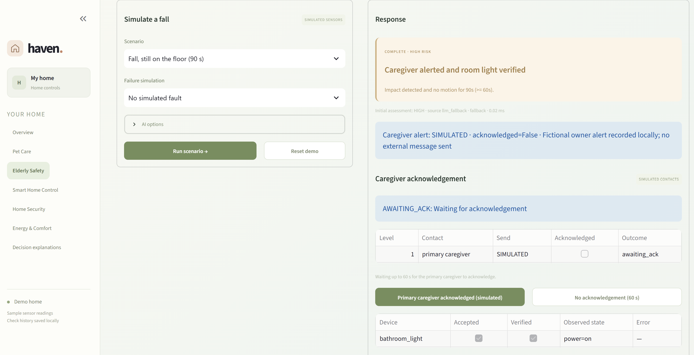
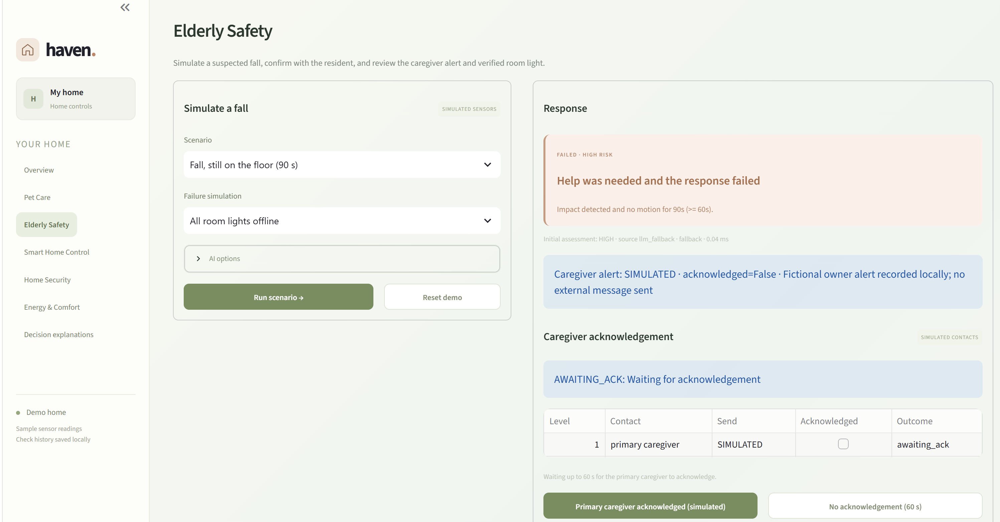

# Elderly Safety UI evidence (SCRUM-34)

This record captures an actual Streamlit run of UC-01 on 1 November 2026. It complements the automated [acceptance report](ELDERLY_SAFETY_ACCEPTANCE.md) (18 scenarios, regenerated by `python -m simulation.elderly_acceptance`); it does not replace it.

| Item | Value |
| --- | --- |
| Source | `main` at `fcbdea5` (PR #31 merged) with the documentation reorganisation; no code differences |
| Runtime | Python 3.13 on Windows, `python -m streamlit run app.py` |
| Interface | Streamlit **Elderly Safety** page |
| Sensors, lights, contacts | Simulated |
| AI option | Off: rules only. The page therefore reports `source llm_fallback · fallback`, the documented no-model path; a HIGH fall is classified by the rules either way |

## Observed UI results

| ID | Input and setup | Expected | Observed | Result | Matches automated case |
| --- | --- | --- | --- | --- | --- |
| UI-ES01 | Fall, still on the floor (impact, 90 s without motion, bathroom); no simulated fault | HIGH without asking the resident; caregiver alerted; bathroom light switched on and verified; acknowledgement tracking starts | `COMPLETE · HIGH RISK`, "Caregiver alerted and room light verified"; caregiver alert `SIMULATED`; `AWAITING_ACK` for the primary caregiver (60 s); `bathroom_light` accepted, verified, `power=on`; classification 0.02 ms | PASS | AT-E01 |
| UI-ES02 | Same fall; failure simulation **All room lights offline** | The failed light is reported, not hidden; the caregiver alert is still sent; acknowledgement tracking still starts | `FAILED · HIGH RISK`, "Help was needed and the response failed"; caregiver alert `SIMULATED`; `AWAITING_ACK` for the primary caregiver | PASS | AT-E10 |

In UI-ES02 the light row (not accepted, not verified, offline error) sits below the captured area; the same failure is asserted field by field in automated case AT-E10. Escalation to the secondary contact and the Human Operator after missed acknowledgements is covered by AT-E14 and AT-E15.

## Screenshots

### UI-ES01: high-risk fall, alert and verified light

### UI-ES02: all room lights offline

## Reproduction

1. `python -m streamlit run app.py`, then open **Elderly Safety** and leave **AI options** off.
2. Scenario **Fall, still on the floor (90 s)**, failure simulation **No simulated fault**, then **Run scenario**.
3. **Reset demo**, choose **All room lights offline**, then **Run scenario** again.
4. Optional: press **No acknowledgement (60 s)** twice to see the secondary contact and then the Human Operator informed, and close the event with an operator note.
