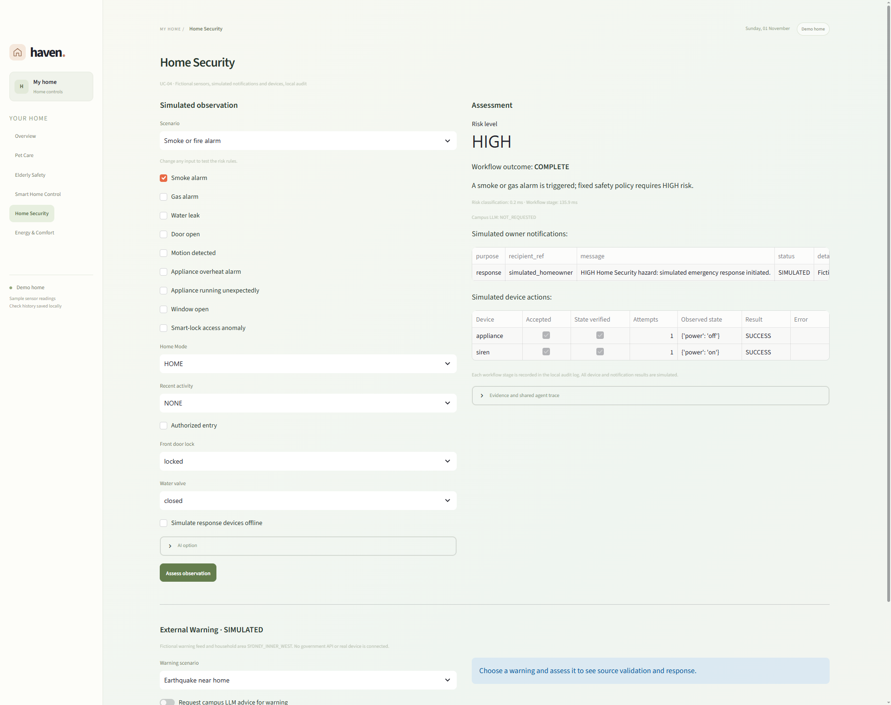
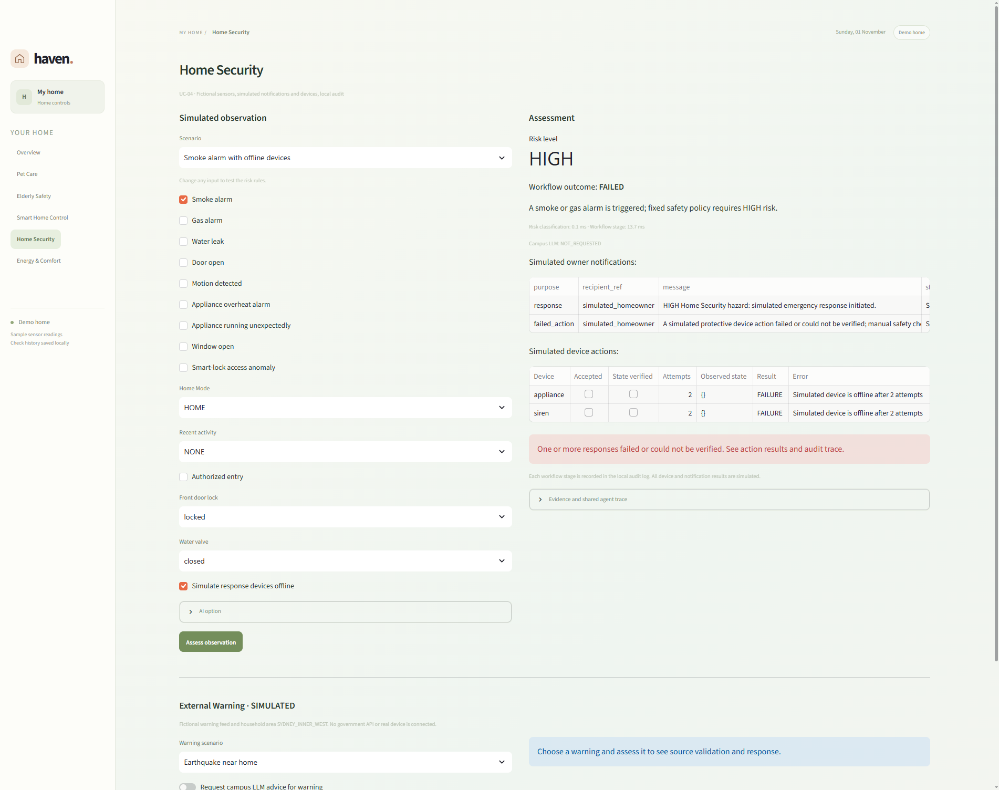

# Home Security scenario acceptance report (SCRUM-37)

AR-04 / UC-04 / OR-06, Member 4: Yan Li. This report consolidates existing acceptance evidence and adds a real browser run of the existing Home Security page. **All sensor inputs, devices, notifications and disaster warnings are simulated.** No physical device or real recipient was contacted.

## Run and source provenance

| Item | Recorded value |
| --- | --- |
| Actual UI run | 1 November 2026, 11:56:34–11:58:52 AEDT (Australia/Sydney) |
| Source commit | `0edfd6f138c39b4a868d5141728eece7cd609226`, local `yan-li` |
| Merged contribution | [PR #15](https://github.com/tianzhuoli11/ELEC5620/pull/15), head `0edfd6f`, merged as `d66f3247e0f208e202e291a4582f4bfb5329d168` |
| Runtime | Python 3.13.7; Streamlit 1.66.0; LangGraph 1.2.16; Windows |
| Browser | Chrome 156.0.8078.79, isolated headless browser session |
| Entry point | Existing `app.py` → Home Security, served only at `127.0.0.1:8517` |
| AI settings | Both campus-advice options disabled; every new assessment records `llm_status=NOT_REQUESTED` |
| Actual results | **7 / 7 acceptance scenarios PASS**, with 8 JSONL workflow-stage records |
| New local audit | `data/runtime/security_acceptance_ui_20261101.jsonl`, git-ignored |
| Repository evidence | This report and the two actual browser screenshots below |

The page was operated through its actual browser controls. The existing shared LangGraph, fixed safety rules, notification adapter and simulated device dispatch/readback executed normally; final results were not injected. Only `ui.home_security.DEFAULT_RECORD_PATH` was redirected **in memory** before startup to the new audit file above, preserving the previous audit file. No application or test source file was edited. The isolated browser/server were closed after capture.

These captures identify their actual source version. GitHub main was separately checked at `c9d957089a52861425cfe50431f264203ea911c2`; it includes PR #15 and later changes. The screenshots are **not** relabelled as captures of that newer commit or the final Canvas archive.

## Input, expected result, actual result and evidence

All unmentioned binary sensors were zero. All new events were marked `simulated=true`. The result column compares the observed behaviour with the expected behaviour: an intentionally failed device response can therefore be a **PASS** for its failure-handling test.

The audit line numbers below refer to the new local audit named above. The full raw log remains local; the actual results are reproduced here so reviewers can read the report without that ignored file.

| ID | Scenario and input | Expected result | Actual result / evidence | Result |
| --- | --- | --- | --- | --- |
| UI-HS01 | **Smoke or fire alarm**: `smoke_alarm=1`; HOME; recent activity NONE; entry not authorized; door lock locked; water valve closed; devices online | HIGH; immediate pre-approved simulated response without ordinary confirmation; appliance off and siren on; independent readback; owner notification and audit | HIGH / COMPLETE; no pending confirmation; appliance returned `power=off`, siren returned `power=on`; both accepted, verified and successful in one attempt; one SIMULATED notification. Audit line 1; [success screenshot](assets/home-security/ui-hs01-smoke-success.png) | **PASS** |
| UI-HS02 | **Smoke alarm with offline devices**: same smoke input, with simulated response devices offline | Keep HIGH; retry within the permitted bound; report failure honestly; record and notify the failed response | HIGH / FAILED; appliance and siren each failed after 2 attempts, `accepted=false`, `verified=false`, observed state `{}`; response and failed-action notifications both recorded as SIMULATED. Audit line 2; [failure screenshot](assets/home-security/ui-hs02-devices-offline.png) | **PASS** |
| UI-HS03 | **Unusual door opening**, then **Reject**: `door_open=1`; AWAY; recent activity NONE; entry not authorized; lock unlocked | MEDIUM; first pause with no device action; explicit rejection must not authorize protection | Initial MEDIUM / AWAITING_CONFIRMATION with zero actions; Reject displayed `Confirmation: rejected`; final COMPLETE with internal verdict `safe` and zero device actions. The two stages have the same event ID. Audit lines 3–4 | **PASS** |
| UI-HS04 | **Normal safe state**: all sensors zero; HOME; recent activity EXPECTED; authorized entry; lock locked; valve closed | LOW; record assessment; no urgent notification or protective action | LOW / ASSESSED; zero actions and zero notifications. Audit line 5 | **PASS** |
| UI-HS05 | **Bushfire near home**: BUSHFIRE / EMERGENCY; source `simulated-course-warning-feed`; area `SYDNEY_INNER_WEST`; active issue/expiry times | Valid and relevant; HIGH; notify and enable only the permitted simulated emergency mode, verifying its state | `valid=true`, `relevant=true`, HIGH / COMPLETE; emergency_mode accepted and verified with `active=true`; one SIMULATED notification. Audit line 6 | **PASS** |
| UI-HS06 | **Flood in another area**: FLOOD / EMERGENCY; trusted simulated source; area `BLUE_MOUNTAINS` | Valid but not relevant to the configured home; LOW; audit only | `valid=true`, `relevant=false`, LOW / ASSESSED; zero actions and zero notifications. Audit line 7 | **PASS** |
| UI-HS07 | **Untrusted storm alert**: SEVERE_STORM / EMERGENCY; home area, but source `simulated-untrusted-feed` | Reject source validation; do not request model advice, notify or dispatch a device | `valid=false`, `relevant=false`; LOW / ASSESSED with validation errors; NOT_REQUESTED; zero notifications and actions. Audit line 8. LOW here does not mean that an invalid warning was authenticated as safe | **PASS** |

## Actual Streamlit screenshots

Both PNGs are unedited captures of the live local page after the workflow and table rendering finished. They contain the selected input, risk/outcome, simulation labels, notifications, device results and observed states. They were not generated illustrations or reconstructed mock-ups.

### UI-HS01 — Smoke protection succeeds

### UI-HS02 — Offline protective devices fail visibly

Each stored image is 1902 × 1504 pixels. The screenshots show `Campus LLM: NOT_REQUESTED`; this run makes no claim of a live campus HTTP request.

## Workflow and audit checks

- UI-HS01's saved trace contains HomeCoordinatorAgent routing, MonitoringAgent's HIGH assessment, DeviceAutomationAgent's appliance/siren verification, HomeCoordinatorAgent notification, and the final result. The audit includes input, assessment reason/evidence, action results, returned states, notification history and both timing fields.
- UI-HS03 records the initial confirmation pause and the actual rejection against the same event. The UI maps the shared internal `safe` verdict to `rejected`; no protective action was issued.
- UI-HS02 preserves the actual failed device results and the independent failed-action notification. A notification record does not turn an unverified action into success.
- UI-HS05–07 preserve the raw fictional warning, simulated source ID, simulation marker, validity and household relevance. An irrelevant or invalid warning dispatches nothing.

## Existing verification retained

The new browser run supplements the earlier automated evidence consolidated in this report; it does not overwrite historical logs.

| Existing evidence | Actual recorded result / scope |
| --- | --- |
| 28 October Home Security core/UI verification | **38 passed**, as recorded in the Member 4 report; this is a historical run, not a newly rerun suite |
| 28 October external-warning verification | **9 passed**, covering all four hazards, rejected input, relevance, model fallback and auditing |
| Integrated repository regression at the accepted local integration | **253 passed, 1 live-proxy test skipped**; distinct from the 7 browser scenarios above |
| [Current main CI, run 41178514735](https://github.com/tianzhuoli11/ELEC5620/actions/runs/41178514735) | Existing successful run on 31 October at `c9d9570`: Python 3.11/3.13 repository tests and container verification; no new full-suite execution was performed for this report |
| Historical local observations | `data/runtime/security_events.jsonl` contains LOW, MEDIUM approval/rejection/timeout, HIGH smoke, device-failure and external-warning observations. It was left unchanged; historical records do not embed an exact Git commit |

Relevant production code is [monitoring.py](../../domains/home_security/monitoring.py), [response.py](../../domains/home_security/response.py), [integration.py](../../domains/home_security/integration.py), [external_warnings.py](../../domains/home_security/external_warnings.py) and the existing [Streamlit page](../../ui/home_security.py).

The following previously executed tests provide the additional confirmation, failure and fallback coverage:

| Area | Corresponding tests |
| --- | --- |
| Risk levels and context | [test_home_security.py](../../tests/test_home_security.py): `test_repeatable_scenario_levels`, `test_context_changes_risk_without_presetting_result`, `test_each_preset_runs_through_shared_workflow` |
| Approve, reject and no reply | Same file: `test_medium_door_requires_explicit_approval_before_actions`, `test_rejection_closes_without_device_action`, `test_timeout_never_grants_medium_device_permission` |
| Failed/unverified actions | Same file: `test_offline_primary_device_uses_siren_as_safe_alternative`, `test_verification_failure_is_not_counted_as_success`, `test_dispatch_exception_is_recorded_and_warning_continues` |
| Notification failure | Same file: `test_failed_smoke_notification_is_recorded_as_partial`, `test_failed_confirmation_notice_never_authorizes_medium_actions`; [test_home_security_ui.py](../../tests/test_home_security_ui.py): `test_failed_confirmation_notice_is_explicit_without_authorizing_actions` |
| Invalid/timed-out model advice | [test_home_security.py](../../tests/test_home_security.py): `test_invalid_llm_output_and_timeout_use_rules`, `test_llm_cannot_downgrade_smoke_or_gas`, `test_model_failure_is_recorded_without_key_or_fake_success` |
| OR-06 | [test_external_warnings.py](../../tests/test_external_warnings.py): `test_all_four_relevant_hazards_use_shared_agents`, `test_irrelevant_valid_warning_is_only_recorded`, `test_untrusted_source_and_missing_fields_cannot_notify_or_act` |

## Defects, fixes and retest evidence

No acceptance expectation failed in the seven new browser scenarios.

| Earlier finding | Fix / verification evidence |
| --- | --- |
| `classification_ms` included the entire workflow | Commit `a3e99aa` separated handler classification from workflow-stage timing. `test_classification_and_workflow_durations_are_recorded_separately` and the recorded regression verify the boundary; the new audit also retains both fields |
| Failed confirmation delivery could be obscured by AWAITING_CONFIRMATION | Commit `a3e99aa` added explicit Home Security delivery-failure messaging, with core and UI failure tests. A pending state does not assert delivery or grant permission |
| Later main needed an explicit rejection-result notification | Commit [`8f4a6f7`](https://github.com/tianzhuoli11/ELEC5620/commit/8f4a6f7e254d4437a9e5163a65c29dd7c4fe2f4c) added it and extended the rejection regression. This later fix is covered by the linked main CI; it is **not** part of source `0edfd6f` used for these screenshots |

The merged PR is evidence of integration, not proof of written peer feedback. This report does not invent a reviewer, meeting or approval.

## Reproduction

Start the existing unified application with `.venv\Scripts\python -m streamlit run app.py`, select **Home Security**, and leave both campus-advice options off.

1. Choose **Smoke or fire alarm**, click **Assess observation**, and wait for COMPLETE plus both verified device rows.
2. Choose **Smoke alarm with offline devices**, click **Assess observation**, and wait for FAILED plus both unverified device rows and the failure warning.
3. Choose **Unusual door opening**, assess, then click **Reject**. Check `rejected` and zero device actions.
4. Choose **Normal safe state** and assess. Check LOW / ASSESSED without notification or device action.
5. In **External Warning · SIMULATED**, assess **Bushfire near home**, **Flood in another area**, and **Untrusted storm alert** separately and compare with UI-HS05–07.

A normal startup uses `data/runtime/security_events.jsonl`. This evidence session redirected only the audit destination in memory to avoid altering that historical file.

## Known limits and group follow-up

- This is functional evidence for the explicitly named PR #15 source. Later main changes, including cross-domain safety-state integration and the rejection-result notification, are not retroactively claimed as part of these captures. If the group requires final-release screenshots, repeat the same steps against that exact main/Canvas version and record its commit.
- All I/O is simulated. No real homeowner delivery, physical protection or trusted government subscription is claimed. The trusted source ID is a simulation allowlist.
- This UI run did not request the campus LLM. Previously recorded model-validation tests and CI remain separate evidence. An injected timeout is not a measurement of a real network timeout.
- The no-reply button simulates expiry of the confirmation window; this report does not claim a background real-time timer.
- Raw runtime JSONL files and browser profiles are not submission artifacts. The new runtime log remains git-ignored; the temporary browser profile was removed. Existing evidence was preserved.
- Final Canvas-archive deployment on the demonstration machine, formal group UC-01–UC-05 acceptance linkage, and actual Review/Retrospective sign-off remain group evidence items; they are not marked complete here.

## Evidence requirement check

- [x] At least one executed success path: UI-HS01.
- [x] At least one executed device/service failure path: UI-HS02.
- [x] At least one executed user-rejection/safety boundary: UI-HS03.
- [x] Each new scenario has input, expected, actual, evidence and PASS/FAIL.
- [x] Two real Streamlit screenshots are stored with this report.
- [x] Actual run date, runtime and full Git commit are identified.
- [x] SCRUM-37, PR #15 and the original Member 4 report are linked.
- [ ] Final submitted-archive deployment and formal group sign-off are outside this evidence run.
