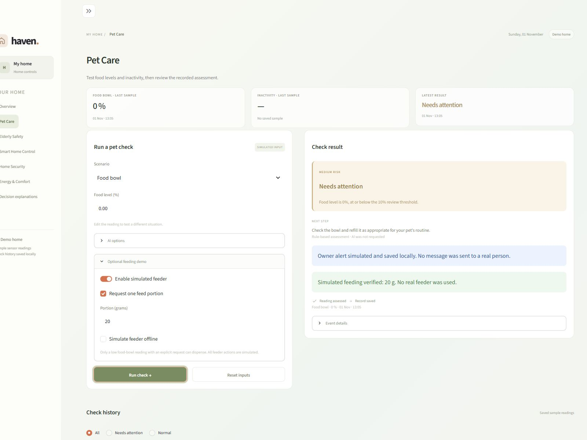
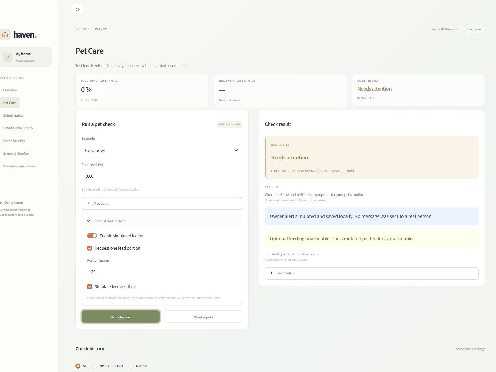
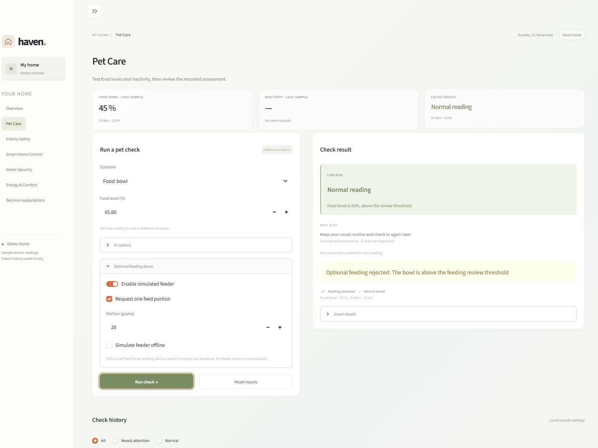

# Pet Care acceptance evidence (SCRUM-36 / SCRUM-29)

Owner: Jinjing Huang. Scope: AR-03 / UC-03 monitoring and owner alerts; OR-01 optional feeding.

| Run metadata | Value |
| --- | --- |
| Date | 1 November 2026, Australia/Sydney |
| Source tested | `b686555` on `main` (before this documentation-only PR) |
| Runtime | Windows, Python 3.13.5; existing installed project environment |
| Inputs / actions | Fictional readings, simulated feeder, locally recorded owner alerts |
| Jira | [SCRUM-36](https://f1orestyinlem.atlassian.net/browse/SCRUM-36), [SCRUM-29](https://f1orestyinlem.atlassian.net/browse/SCRUM-29) |

## Actual workflow acceptance results

Each row was executed through `monitor_pet_workflow`, the shared agent graph, and a temporary JSONL record. Every row also checked that the saved feeding status matched the returned outcome. These are observed results, not proposed test cases. [Machine-readable evidence](../evidence/pet_care_acceptance_2026-11-01.json) contains the full source commit, timestamp, expected and actual values.

| ID | Input / setup | Expected | Actual | Result |
| --- | --- | --- | --- | --- |
| PET-01 | Bowl 0%; feeding enabled; explicit 20 g request; feeder available | MEDIUM; VERIFIED; one dispatch; simulated alert | MEDIUM; VERIFIED; 1 dispatch; SIMULATED alert; record saved | PASS |
| PET-02 | Same as PET-01; feeder offline | UNAVAILABLE; zero dispatches; core monitoring and alert continue | MEDIUM; UNAVAILABLE; 0 dispatches; SIMULATED alert; record saved | PASS |
| PET-03 | Bowl 45%; feeding enabled; explicit 20 g request | Feeding REJECTED above threshold; no dispatch or alert | LOW; REJECTED; 0 dispatches; no alert; record saved | PASS |
| PET-04 | Same as PET-01; preflight adapter raises TimeoutError | UNAVAILABLE; monitoring, alert and record still complete | MEDIUM; UNAVAILABLE; 0 dispatches; SIMULATED alert; record saved | PASS |
| PET-05 | Same as PET-01; stale feeder readback | UNVERIFIED; exactly one dispatch; no blind retry | MEDIUM; UNVERIFIED; 1 dispatch; SIMULATED alert; record saved | PASS |
| PET-06 | Same as PET-01; notifier returns FAILED | Verified feed retained separately; workflow PARTIAL | VERIFIED feed; FAILED alert; PARTIAL workflow; record saved | PASS |
| PET-07 | Bowl 0%; AI provider raises TimeoutError; no feeding request | Fixed-rule MEDIUM; fallback; alert; no feeding | MEDIUM; fallback_used=true; NOT_REQUESTED; SIMULATED alert; record saved | PASS |
| PET-08 | Bowl 45%; no feeding request | LOW; no alert or dispatch | LOW; NOT_REQUESTED; no alert; 0 dispatches; record saved | PASS |

Additional repository tests cover malformed feeder state, invalid portions, same-event duplicate dispensing, inconsistent AI proposals, inactivity thresholds and the feeding-disabled path.

## Automated and live verification

- `python -m unittest discover -s tests -p "test_pet*.py" -v`: **30 tests passed**.
- `python -m unittest discover -s tests -p test_ui.py -v`: **10 tests passed**. This suite covers the shared Overview and Pet Care interfaces, reset, persisted results, feeding success/offline handling, history and navigation.
- Separate actual campus model request: `python -m simulation.pet_demo --scenario normal_activity --use-campus-llm --output data/runtime/pet-final-review.jsonl`. Observed **LOW**, **fallback_used=false**, **ASSESSED**, feeding **NOT_REQUESTED**. This is one successful smoke test, not a model accuracy benchmark or a guarantee of venue connectivity.
- Eight workflow scenarios in the table above: **8/8 passed**. Failure paths use controlled simulated failures; no external owner notification was sent.

## Real Streamlit screenshots

Captured directly from the running source above on 1 November 2026 using a 1600 x 1200 browser viewport. The captures contain the application only; they are not mockups and do not include chat UI. AI was disabled for these three UI scenarios. No credentials are shown.

### PET-01 — Verified simulated feed

Bowl 0%, feeder enabled, explicit 20 g request, offline simulation off. The result reports a verified feed and a locally simulated owner alert.

### PET-02 — Feeder offline, monitoring continues

Bowl 0%, feeder enabled, explicit 20 g request, offline simulation on. Feeding is unavailable while the owner alert and record still complete.

### PET-03 — Safety refusal above feeding threshold

Bowl 45%, feeder enabled, explicit 20 g request, offline simulation off. The result refuses feeding because the bowl is above the review threshold; no owner alert is needed.

## Reproduce on the demonstration machine

1. Install the submitted source dependencies using the deployment instructions, then run `python -m streamlit run app.py`.
2. Open **Pet Care**, select **Food bowl**, and leave AI off for deterministic device demonstrations.
3. Open **Optional feeding demo**, enable the simulated feeder and request one 20 g portion. Set food level to 0% and run the check: PET-01.
4. Enable **Simulate feeder offline** and rerun: PET-02. Check that the alert remains recorded and feeding reports unavailable.
5. Turn offline simulation off, change food level to 45%, and rerun: PET-03. Check the rejection and lack of an owner alert.
6. For a normal inactivity example, reset inputs and select **Normal activity**. For a high-risk example, select **Activity check** (150 minutes).
7. Check the result and local history after each run. An input change clears the previous result until a new check runs.
8. Optionally enable campus AI after configuring the personal key outside the source archive and connecting to the required network/VPN. If the provider fails, confirm explicit rule fallback.

## Scope

All feeding, readings and owner alerts are simulated. Event replay protection is local to the same simulated feeder instance, not durable protection across application restarts. Keep keys and runtime logs outside the source archive. Historical Sprint 2 results remain in [JINJING_SPRINT2.md](../member-notes/JINJING_SPRINT2.md); the counts there describe earlier commits.
