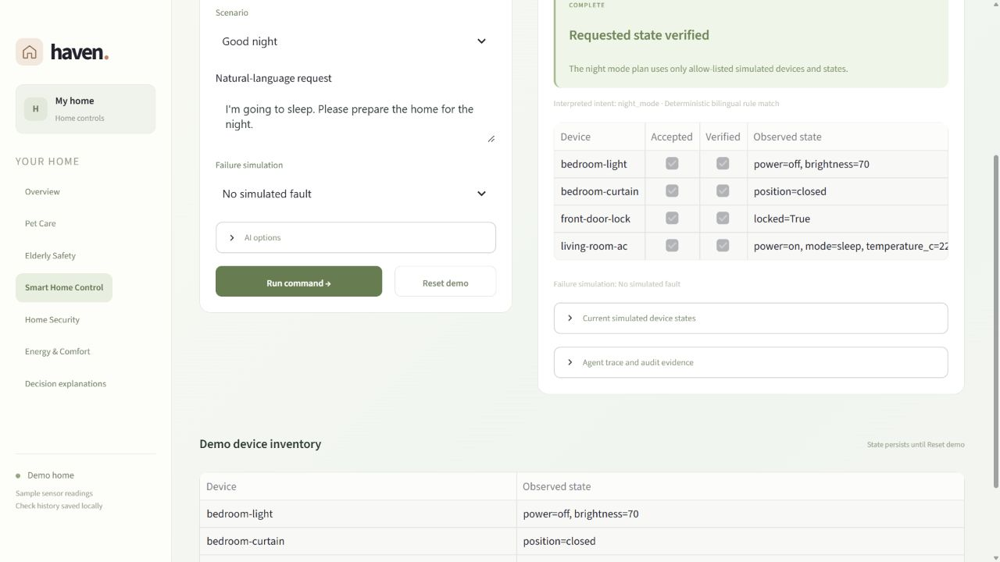
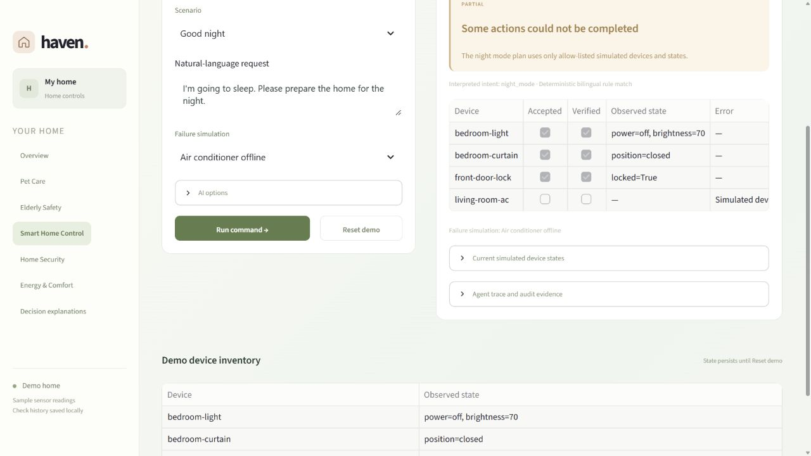
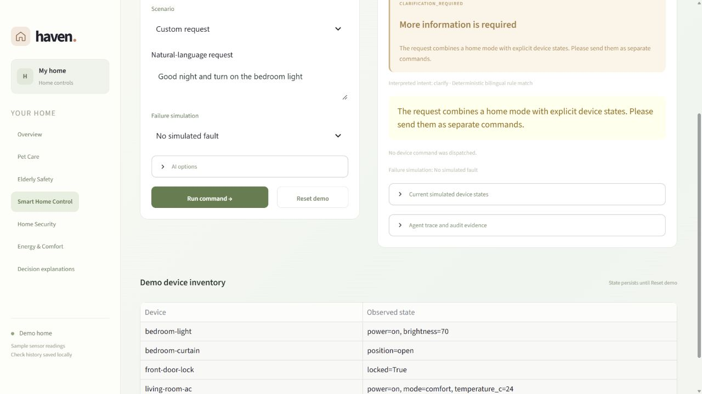
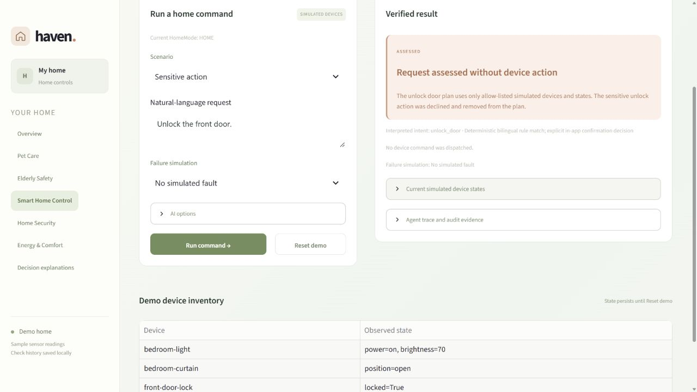

# Smart Home Control UI evidence (SCRUM-35)

This record captures an actual Streamlit run of UC-02 on 31 October 2026. It complements the automated acceptance report; it is not a claim that physical devices or the live campus model were used.

| Item | Value |
| --- | --- |
| Source base | `main` at `78c3506` (PR #24 merged) |
| Runtime | Python 3.13.5 on Windows 11 |
| Interface | Streamlit Smart Home Control page |
| Device integration | Simulated devices |
| AI option | Disabled; deterministic policy path |
| Jira evidence | [SCRUM-35](https://f1orestyinlem.atlassian.net/browse/SCRUM-35) comment and attachments |

## Observed UI results

| ID | Input and setup | Observed result | UI evidence |
| --- | --- | --- | --- |
| UI-SH01 | `Good night`; no simulated fault | `COMPLETE`; 4/4 actions accepted and verified; `HomeMode=NIGHT` | [Good Night screenshot](assets/smart-home/ui-sh01-good-night.png) |
| UI-SH02 | `Good night`; Air conditioner offline | `PARTIAL`; 3/4 actions verified; AC reports `Simulated device is offline after 2 attempts`; `HomeMode=HOME` | [AC-offline screenshot](assets/smart-home/ui-sh02-ac-offline.png) |
| UI-SH03 | `Good night and turn on the bedroom light` | `CLARIFICATION_REQUIRED`; the UI asks for separate commands; zero device commands dispatched | [Conflict screenshot](assets/smart-home/ui-sh03-conflict.png) |
| UI-SH04 | `Unlock the front door.` followed by `Keep door locked` | `ASSESSED`; zero device commands dispatched; front door remains `locked=True` | [Declined-unlock screenshot](assets/smart-home/ui-sh04-unlock-denied.png) |

The four screenshots were captured directly from the browser after each scenario completed. They are stored both in this repository and as attachments to SCRUM-35 so that the Canvas source archive remains self-contained. The unrelated image briefly shown in Windows Paint was an older clipboard image and is deliberately excluded from this evidence set.

## Repository screenshots

### UI-SH01 — Good Night success

### UI-SH02 — Air conditioner offline

### UI-SH03 — Conflicting request

### UI-SH04 — Declined unlock

## Reproduction steps

1. Start the app with `python -m streamlit run app.py`.
2. Open **Smart Home Control** and leave **AI options** disabled.
3. Select the scenario and failure simulation shown in the table.
4. Run the command and check the status card, action read-backs, current `HomeMode` and demo device inventory.
5. Select **Reset demo** before the next scenario.

## Reviewer checklist

- [ ] Reproduce UI-SH01 and confirm all four actions are verified and the mode becomes `NIGHT`.
- [ ] Reproduce UI-SH02 and confirm the run is `PARTIAL`, not `COMPLETE`.
- [ ] Check that UI-SH03 dispatches no device command.
- [ ] Check that declining UI-SH04 leaves the front door locked.
- [ ] Confirm the Jira screenshots match this record and the automated acceptance report.
- [ ] Record any discrepancy in the PR or SCRUM-35 before approval.

## Evidence links and limitations

- Automated cases and detailed expected/actual values: [SMART_HOME_CONTROL_ACCEPTANCE.md](SMART_HOME_CONTROL_ACCEPTANCE.md)
- Safety and integration hardening: [PR #23](https://github.com/tianzhuoli11/ELEC5620/pull/23)
- Automated acceptance evidence: [PR #24](https://github.com/tianzhuoli11/ELEC5620/pull/24)
- This run used simulated devices and did not call campus-qwen.
- Rehearsal from the exact Canvas source archive on the demonstration laptop remains a separate deployment task.

